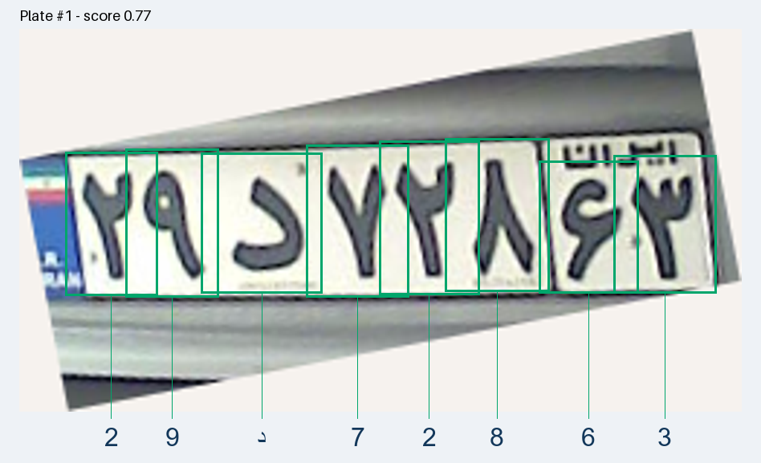
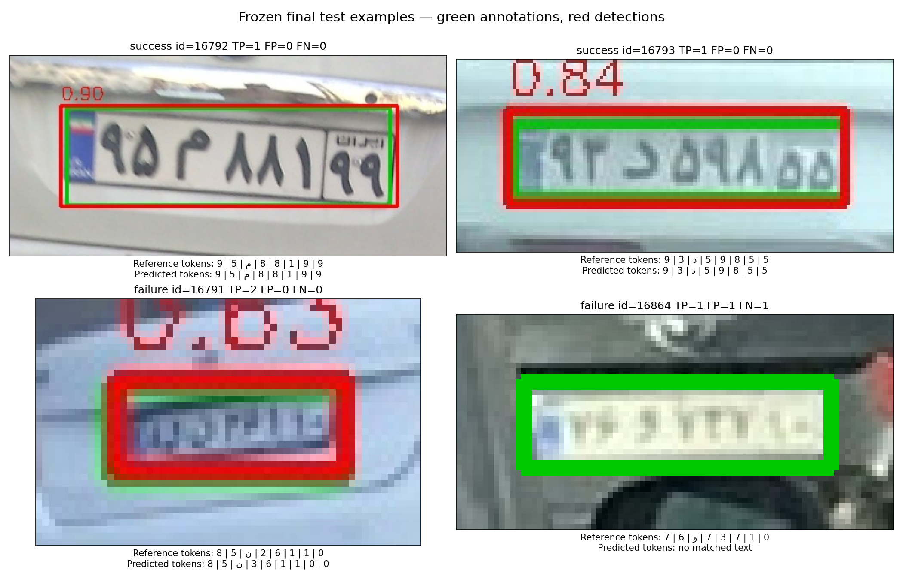

# Persian ALPR

Persian license plate detection and recognition using two YOLOv8n models: one locates plates in a full image, and the other detects and classifies characters inside each plate crop. A HOG + SVM character-classification baseline is included in the training notebook.



## Verified results

| Metric | Result | Evaluation scope |
|---|---:|---|
| Plate detection mAP50 | 98.36% | Test images |
| Plate detection mAP50-95 | 77.53% | Test images |
| Exact full-plate text accuracy | 85.81% | Test plates with reconstructed XML text references |
| Character error rate (CER) | 6.42% | Full pipeline on eligible test plates |
| HOG + SVM character accuracy | 89.43% | Validation reference character crops |
| HOG + SVM macro F1 | 0.7511 | Validation reference character crops |

These are preserved results from the previous full training experiment, not a new full training run of the simplified notebooks. SVM character classification and full-plate recognition are different tasks. See [RESULTS.md](RESULTS.md) for definitions, verification, and limitations.

## Install dependencies

The verified environment uses Python 3.10. From the project root, create an environment and install dependencies. The following PowerShell commands use the CUDA build tested on the original NVIDIA GPU environment:

```powershell
py -3.10 -m venv .venv-gpu
.\.venv-gpu\Scripts\python.exe -m pip install torch==2.11.0 torchvision==0.26.0 --index-url https://download.pytorch.org/whl/cu128
.\.venv-gpu\Scripts\python.exe -m pip install -r requirements.txt
.\.venv-gpu\Scripts\python.exe -m pip check
```

For CPU use, install a compatible CPU build of torch and torchvision instead of the CUDA pair above. The code selects CPU when CUDA is unavailable. Select `.venv-gpu/Scripts/python.exe` as the notebook kernel in VS Code or Jupyter; `ipykernel` is included in the requirements.

## Run the demo

1. Download [Persian-ALPR-models.zip](https://github.com/sepehrsardar/Persian-ALPR/releases/download/v1.0.0/Persian-ALPR-models.zip).
2. Extract it into the project root. It contains the `models` folder with both trained YOLO checkpoints, the SVM model, and `settings.csv`.
3. Run:

```powershell
.\.venv-gpu\Scripts\python.exe demo.py
```

The demo displays each complete plate crop, draws character boxes, and places each predicted symbol below its box. A PNG preview and CSV predictions are saved to `outputs/demo`.

The demo requires the model files and installed dependencies; it does not require the dataset or either notebook. A detection confidence score is not a guaranteed percentage of text correctness.

Perspective correction is experimental and off by default because the previous method reduced overall validation accuracy. Incorrect border selection can make a prediction worse.

## Project files

```text
prepare_data.ipynb   Validate annotations and archive duplicate/similar images
Iranian_ALPR.ipynb   Load prepared data, train, evaluate, predict, and compare SVM
predict.py          Shared model loading, inference, and visualization
demo.py             Desktop image-selection demo
test_predict.py     Small inference regression tests
requirements.txt    Python dependencies; install torch/torchvision separately
README.md           Setup and execution guide
RESULTS.md          Verified results, checks, and limitations
models/             settings.csv; trained weights downloaded from the release
assets/             Verified metric tables, reports, and example images
```

Local/generated folders are excluded from Git:

```text
new_dataset/        Source images and XML annotations
prepared_data/      CSV indexes produced by data preparation
duplicate_photos/   Review archive, paired XML files, and transfer manifests
outputs/            Run-specific datasets, checkpoints, and reports
archive/            Local historical code and maintenance tools
```

The active code does not depend on the historical `alpr/` or `tools/` packages. Notebook settings are defined in code cells; output tables use CSV. YOLO dataset YAML files are generated automatically. No separate JSON configuration file is required.

## Prepare data and use the notebook

Training requires a local annotated dataset; a public dataset download link is not currently provided. Place image/XML pairs in:

```text
new_dataset/
    train/
    validation/
    test/
```

Each JPG has a corresponding XML file. The plate class is named `کل ناحیه پلاک` in the source annotations, and there are 31 character classes.

1. Run **`prepare_data.ipynb`** with **Run All** for a new or modified dataset. It checks decoded image dimensions, corrupt files, missing pairs, invalid boxes, and exact/approximate duplicates.
2. Run **`Iranian_ALPR.ipynb`** with **Run All**. It reads the prepared indexes without repeating the expensive similarity scan. Missing indexes produce an instruction to run preparation first.

Preparation writes `images.csv` (image metadata and the `keep` selection), `boxes.csv` (annotations), and `issues.csv` (errors and warnings) to `prepared_data`. Only `keep=1` images enter the main pipeline. Source hashes are checked when generating training inputs. Rerun preparation after adding, deleting, or changing source files.

Choose `MODE` in the first code cell:

| Mode | Behavior |
|---|---|
| `"saved"` | Default: load trained models, display historical results, and predict a new image; no training. Full notebook execution still requires the dataset and prepared indexes. |
| `"smoke"` | Use up to 16 training and four validation images, train each YOLO model for one epoch, and fit a small SVM baseline. Test is not evaluated. |
| `"train"` | Build YOLO inputs, train models, select thresholds on validation, evaluate, and fit/evaluate the SVM baseline. |

The previous full experiment took approximately 1.5 hours of model training on an RTX 4070 Laptop GPU. New runs can take a different amount of time. The simplified version has not been retrained for a full 60-epoch schedule; run `smoke` before starting long training. Each run saves new models in its own output directory without replacing existing checkpoints.

Set `NEW_IMAGE` to the image path to test. `RECTIFY_NEW_IMAGE` controls the optional perspective correction and defaults to `False`.

For training, also place the official COCO initialization checkpoint at `models/yolov8n.pt`; see the [official Ultralytics asset release](https://github.com/ultralytics/assets/releases/tag/v8.3.0). This initialization checkpoint is different from this project's trained plate and character detectors.

## Review duplicate and similar images

Preparation **modifies the source dataset** by archiving surplus image/XML pairs after verified copies have been made. It retains one member per similarity group, preferring test, then validation, then train. This is a similarity-based safeguard, not a guarantee of independent vehicles or scenes.

Each run gets a separate folder. Example naming:

```text
duplicate_photos/<run>/group_000123/
    day_00123_original_test.jpg
    day_00123_original_test.xml
    day_00987_duplicate1_train.jpg
    day_00987_duplicate1_train.xml
    day_00456_duplicate2_validation.jpg
    day_00456_duplicate2_validation.xml
```

These names are illustrative. `original` means the retained group member, not necessarily the first camera image or the best-quality image. Its source files stay in the dataset and are also copied into the archive. Other group members, including approximately similar images, are copied with their XML files. Source and destination hashes are verified before each surplus source file is removed.

The run's `manifest.csv` records old/new paths, role, split, hash, and status for each file. `copied` indicates a verified copy; `moved` indicates a surplus source file has been removed. If interrupted, inspect the manifest and both locations before rerunning. Completed removals are not automatically rolled back; the backups remain. To restore files, copy archived destinations back to their recorded source paths and rerun preparation.

The first prepared index retains excluded rows with `keep=0`; their old source paths no longer exist after transfer. Subsequent runs rescan the cleaned source folders and leave previous archives intact. Invalid image/annotation pairs are reported, not moved into the duplicate archive. Duplicate removal does not fix all annotation or data-quality problems.

## Evaluation boundaries

- Character training and standalone character detection evaluation use reference plate crops. Full inference uses crops predicted by the plate detector.
- Crops inherit their source image's split. Plates without character labels are not treated as negative character samples.
- Text references are reconstructed from XML and may be incomplete. Missed eligible plates count as text errors; plates without character references are counted separately.
- SVM receives reference character crops and does not locate plates or characters. Its validation score was used to select `C` and is not an independent test estimate.
- **The test set has already been consumed.** Settings are selected using validation, but evaluating the same test again is not a fresh independent estimate. New final improvement claims require a new independent holdout.



## Run tests

```powershell
.\.venv-gpu\Scripts\python.exe -m unittest test_predict -v
```

The repository includes code, both notebooks, documentation, small CSV settings, and example assets. The dataset, generated indexes, duplicate archive, environments, run outputs, and weights are excluded by `.gitignore`. Trained weights are distributed through [release v1.0.0](https://github.com/sepehrsardar/Persian-ALPR/releases/tag/v1.0.0).
